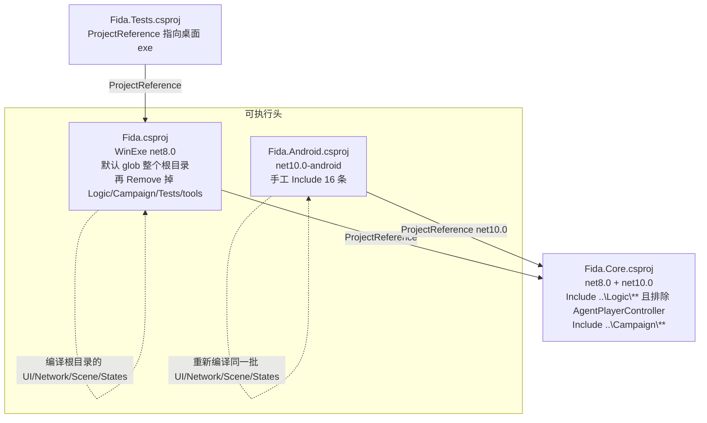
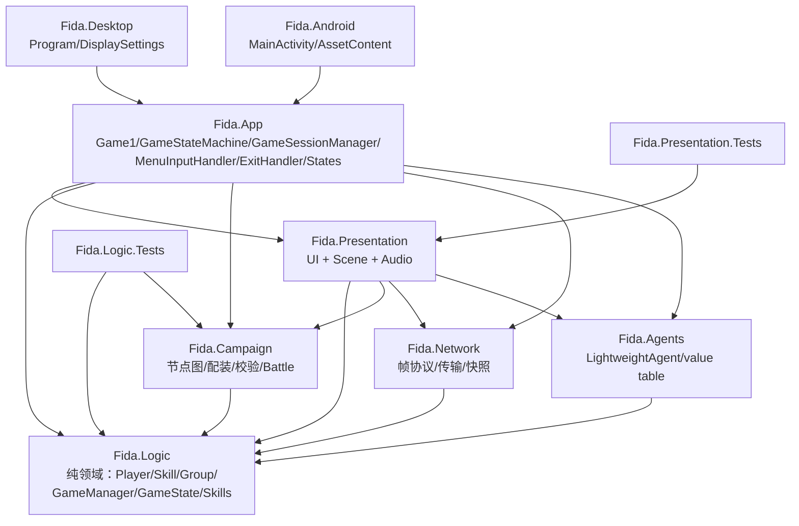

# Fida 模块化重构探索

> 本文是**只读分析结论**，没有改动任何源码。
> 所有结论都可用 §9 的测量方法复现；引用位置使用 `文件:行号`。

## 1. 一句话结论

Fida 的**领域逻辑其实已经很干净**（`Logic/` + `Campaign/` 零引擎依赖），真正的问题不在"代码写得乱"，而在三个**结构性错位**：

1. **程序集边界是编译技巧，不是设计**——`Fida.Core` 用 `..\Logic\**` 反向 include 根目录的源码，桌面工程又把自己目录下的 `Logic/`、`Campaign/` 全部 `Remove` 掉；Android 工程再手工复制 16 条 `Compile Include`。
2. **领域模型被 UI 反持**——`GameManager` 由 `UIManager` 构造并持有，于是所有非 UI 代码想拿模型都必须先拿 UI。
3. **流程编排散落在三处并列的 `switch (State)` 里**，而 `States/` 里那套 `IMenuState` 只处理输入、不负责建屏，导致"加一个界面要改 4 个文件"。

所以重构的主线不是重写，而是**把已有的正确分层"落地"成物理结构**，顺便删掉一批确实死掉的代码。

---

## 2. 现状实测

### 2.1 规模

| 范围 | 文件 | 行数 |
|---|---:|---:|
| 生产代码 | 190 | 22,478 |
| 测试（`Fida.Tests`） | 33 | 3,656 |
| 工具（`tools/*`） | 5 | 1,592 |
| **合计** | **228** | **27,726** |

超过 300 行的生产文件 13 个，全部集中在 `UI/`、`Network/` 和三个 `*Manager`：

| 行数 | 文件 | 其中 Android 专属 |
|---:|---|---:|
| 1149 | `UI/Campaign/UICampaignMap.cs` | 611（53%） |
| 841 | `UI/Campaign/UICampaignSkillWheel.cs` | 296（35%） |
| 713 | `UI/UIPlayerManager.cs` | 167 |
| 668 | `UI/UIPaper.cs` | 0 |
| 576 | `Network/NetworkManager.cs` | 0 |
| 549 | `UI/UIPlayer.cs` | 144 |
| 483 | `GameSessionManager.cs` | 0 |
| 445 | `UI/UIScreenBuilder.cs` | 249（56%） |
| 395 | `UI/UIManager.cs` | 6 |
| 377 | `Scene/PlayingSceneManager.cs` | 0 |
| 374 | `UI/UIButtonBase.cs` | 0 |
| 374 | `Logic/GameManager.cs` | 0 |
| 359 | `UI/UIInputHandler.cs` | 0 |

> 全仓 `#if/#else/#endif` 共 333 行，其中 `FIDA_ANDROID` 分支内的专属代码 **1735 行**，分布在 30 个文件里。

### 2.2 现状程序集与编译关系



关键事实：

- `Fida.Core.csproj:9-10` 把**物理上属于根项目目录**的 `..\Logic\**`、`..\Campaign\**` 拉进自己的程序集；`Fida.csproj:22-24` 再把它们 `Remove` 掉，只单独 `Include Logic\AgentPlayerController.cs`。
- `Fida.Android.csproj` 用 `<Compile Include="..\UI\**\*.cs" LinkBase="UI" />` 等 16 条把**同一批源码再编译一遍**（5 条目录 glob + 11 条单文件）。
- `Fida.Tests` 引用的是桌面 **WinExe**，因此测试会连带编译全部 UI、并依赖 MonoGame 内容管线产物（见 §7）。
- 因此源码文件"所在目录"和"所属程序集"完全脱钩：`Logic/` 的代码不在 `Fida` 里，`UI/` 的代码在两个程序集里各有一份。

### 2.3 模块间依赖（按 `using` 统计，文件级）

```
Logic      -> Agent     1     ← 仅 AgentPlayerController.cs
Logic      -> Campaign  1     ← 仅 GameSetup.cs
Campaign   -> Logic    11
Campaign   -> Agent     1
Network    -> Logic     6
Network    -> Campaign  1     ← NetworkManager.SendCampaignPresence / OnlineModeRules
UI         -> Logic    11
UI         -> Campaign  4
UI.Campaign-> Campaign 11
UI.Campaign-> Logic    10
MenuStates -> UI 7  Logic 5  Campaign 5  Network 3  UI.Campaign 4
Scene      -> UI 1  Logic 2  Campaign 2  Network 1  Agent 1
App(root)  -> Network 5  Logic 4  UI 4  Scene 3  Agent 2  Audio 1  Campaign 1  MenuStates 1
```

分层大体成立，但存在 **3 处环**：

| 环 | 证据 | 后果 |
|---|---|---|
| `Logic ↔ Campaign` | `Logic/GameSetup.cs:3,42-43,95-96` | 二者永远不能拆成两个工程 |
| `Logic ↔ Agent` | `Logic/AgentPlayerController.cs:1` ←→ `Agent/AgentManager.cs:5` | 只能靠 csproj 把该文件从 Core 里排除来"打补丁" |
| `Network → Campaign` | `Network/NetworkManager.cs:8,108`、`Network/OnlineModeRules.cs:31-32` | 传输层反向依赖战役进度与技能计价 |

---

## 3. 问题清单（按 ROI 排序）

### P1　程序集边界 = 编译技巧　【严重】

**现象**：三个 csproj 各自维护一份"哪些文件属于我"，且与磁盘目录互相矛盾。

**证据**

- `Fida.Core/Fida.Core.csproj:9-10`：`Include="..\Logic\**\*.cs"`、`Include="..\Campaign\**\*.cs"`
- `Fida.csproj:22-24`：`Remove="Logic\**\*.cs"`、`Remove="Campaign\**\*.cs"`、`Include="Logic\AgentPlayerController.cs"`
- `Fida.Android/Fida.Android.csproj`：16 条 `Compile Include="..\..."`，其中 11 条是**单个文件**的显式 Include（根目录 9 个 + `Agent\AgentManager.cs`、`Logic\AgentPlayerController.cs`）
- `Logic/AgentPlayerController.cs` 被"踢出" Core，唯一原因是它引用了 `Fida.Agent`

**代价**

- 新增一个根目录文件，必须同时改 2 个 csproj；漏改不会报错，只会在 Android 上悄悄不编译。
- 同一份代码在两个程序集里编译，`#if` 与 `Nullable` 上下文不同（见 P11），行为可能不一致。
- `Fida` 是 `WinExe`，不是库：测试、`tools/UiPreview` 只能引用可执行文件，无法引用"展示层"。
- 改一个 UI 文件要重新编译整个 Android 工程的全部 UI。

**修法**：只保留一个事实来源——源文件物理位置 = 所属工程（§4、§5 阶段 1）。

---

### P2　领域模型被 UI 反持　【严重】

**证据**

- `UI/UIManager.cs:89`：`GameManager = new GameManager();`
- `UI/UIManager.cs:64`：`public GameManager GameManager { get; private set; }`
- 调用点：`GameSessionManager.cs` 15 处、`Game1.cs` 3 处、`GameStateMachine.cs` 2 处、`States/StateBase.cs` 1 处

**代价**

- 任何想拿模型的地方都得先拿 `UIManager`：`_uiManager.GameManager.Query.Xxx` 这种"借道两层"的写法遍布会话层。
- `Scene/PlayingSceneManager` 的构造签名是 `(GameManager, UIManager, AgentManager)`，而它自己又调用 `_uiManager.BuildPlayingUI(...)`——**场景层反过来指挥 UI 建屏**（`Scene/PlayingSceneManager.cs:108,135,163,173,206`）。
- 无法在无 UI 的情况下驱动一整局（这对测试和 Headless 平衡性模拟是硬伤）。

**修法**：让组合根（`Fida.App`）创建 `GameManager` 并注入 UIManager；UI 只保留"渲染 + 命中测试"，建屏请求由 App 层发起。

---

### P3　三处并列的 `switch (State)` + 只做输入的 `IMenuState`　【严重】

**证据**

1. `GameStateMachine.cs:76-109`：16 个 case，**边切状态边建 UI**
2. `MenuInputHandler.cs:24-40`：`Dictionary<State, IMenuState>`，再在 `:79-98` 提供三个**函数体完全相同**的入口
3. `Game1.cs:137-163`：16 个 case 标签，其中 12 个都调同一个 `_menuInput.HandleMenuInput`

`States/` 里已经有 `IMenuState`（`States/IMenuState.cs`）+ `StateBase`，但只承担"绑按钮 / 处理输入"，建屏仍在 `GameStateMachine`。

另外 `MenuInputHandler.HandleHostingInput` / `HandleConnectingInput` 与 `HandleMenuInput` 一行不差（`:79-98`），是纯冗余抽象。

**代价**

- 新增一个界面要改 `State.cs`、`GameStateMachine` switch、`MenuInputHandler` 字典、`Game1` switch 四处，每处都可能漏。
- "这个界面怎么进、进来做什么"的信息被切到两个文件，读代码需要在两者间跳跃。
- 状态机的分支正确性无法被单测覆盖（`Dictionary` 缺 key 就是运行期异常）。

**修法**：把 `IMenuState` 升级为 `IScreenState { State Id; void Build(); void HandleInput(GameTime); OnEnter/OnExit }`，三个 switch 塌缩成"查表 + 多态"两行。战斗界面（`Playing`/`OnlinePlaying`）作为 `IScreenState` 的实现委托给 `GameSessionManager`。

---

### P4　静态全局脊柱　【高】

**证据**（都会在任意位置被隐式读写）

| 类型 | 位置 | 问题 |
|---|---|---|
| `GameSetup` | `Logic/GameSetup.cs:11-98` | 静态可变单例：当前节点、已选技能、当前场景全在这；`SelectCampaignNode` 内部读 `CampaignRuntime` 与 `CampaignLoadout`（这里正是 `Logic→Campaign` 唯一的边） |
| `CampaignRuntime` | `Campaign/CampaignRuntime.cs:39-70` | 静态门面 + 两个文件 IO 槽位 |
| `CampaignCatalog` | `Campaign/CampaignCatalog.cs:12,25-32` | 静态字段初始化里做文件 IO 与校验，失败即抛异常 |
| `UIPaper` | `UI/UIPaper.cs` | 按 `GraphicsDevice` 做 key 的静态资源缓存，`ResourceManager.cs:107-128` 往里注册 6 组图集；还包含 `CampaignNodeArtworkIndex`（战役领域知识） |
| `GameManager.LocalPlayerId` | `Logic/GameManager.cs:53` | 可写公共属性，联机时由 `GameSessionManager.cs:204,248` 直接改模型 |

**代价**：隐式时序耦合——`GameSetup.SelectedNode` 被 UI 建屏（`UI/UIScreenBuilder.cs:136,138,145-150`）、状态机开局（`GameStateMachine.cs:86`）、音频策略（`Game1.cs:178-182`）三处各自读取，"什么时候选好了"没有任何编译期约束。

**修法**：先收敛读取点（把 `GameSetup` 换成一个由 App 持有的 `LoadoutSelection` 实例，注入到需要的 3 个组件）；`CampaignCatalog/Runtime` 保留静态外观但把 IO 挪到已有的 `CampaignProgressStore` 接口后面。这样 §2.3 里 `Logic→Campaign` 那条边直接消失。

---

### P5　`GameSessionManager` 承担 6 件事，且战斗输入循环写了两遍　【高】

**证据**（`GameSessionManager.cs`，483 行）

| 职责 | 位置 |
|---|---|
| 单机/联机开局装配 | `168-256` |
| 断线策略（4 种模式分支） | `107-163` |
| 战斗输入循环（**写了两遍**） | `261-294` 与 `299-335` |
| 教程提示触发条件（硬编码 `"T01"`/`"T02"`/`"T03"`） | `356-423` |
| 观战者入场快照协议 | `455-481` |
| 战役 presence 合并 | `110-115` |

**输入循环重复度实测**：两份方法体规范化后 24 / 27 行，其中 **19 行完全相同**（78%）。差异只有 5 行：状态名、`ProcessMessages`、`_awaitingBattleJoinAcknowledgement` 门禁、`TrySendBattleJoinSnapshot`、`TrackTutorialReinforcements`。

**代价**：两处改动必须同步；教程/断线/快照这些横切逻辑都在同一个类里争夺同一批字段。

**修法**：合并为 `RunBattleInput(IBattleInputSource source, bool online)`；把教程提示、断线策略、入场快照各自抽成独立协作者。

---

### P6　"给每个玩家分配控制器"的规则复制了 5 份　【高·隐蔽】

**证据**：`Scene/PlayingSceneManager.cs`

| 位置 | 变体 |
|---|---|
| `65-79` `InitializeControllers(players)` | `localId ? Local : Agent` |
| `84-98` `InitializeControllers(players, localId)` | `localId ? Local : Remote` |
| `125-130` `InitializeCampaign` | `remote ? Remote : (!controlAgents && 有 AgentType ? Remote : Factory)` |
| `154-160` `InitializeCampaignFromSnapshot` | 同上但多一处条件 |
| `198-208` `OnReinforcementsDeployed` | 再一份 |

五处的判定条件**互不相同但语义重叠**，其中 `!controlAgentsLocally && setup.AgentTypes.ContainsKey(id)` 出现 3 次，`player.IsAlive()` 只在 `ContinueCampaignAfterPartnerDisconnect`（`367-368`）里出现。

**代价**：联机战役的"谁模拟 AI"这条规则一旦调整，极易漏改一处，表现为"双端都跑 AI"或"双端都不跑"——这类 bug 只在双设备联机时暴露。

**修法**：抽 `IPlayerControllerPolicy.CreateFor(playerId, context)`，把 5 处判定收敛成 1 处纯函数，并用表驱动单测覆盖 5 种组合。

---

### P7　`#if FIDA_ANDROID` 把三个大类劈成两半　【高】

**证据**：Android 专属代码 1735 行 / 30 文件。最严重的三个：

- `UI/Campaign/UICampaignMap.cs`：`1149` 行里 `611` 行只在 Android 编译（`:68-76` 的字段、`:151-153`、`:297-378` 起的移动端面板/列表/模态框）。桌面侧是"相机 + 缩放 + 拖拽 + 图结构"，Android 侧是"卡片列表 + 详情弹层"，**是两种界面，不是一种界面的两种实现**。
- `UI/Campaign/UICampaignSkillWheel.cs`：`29` 个 `#if` 块，296 行 Android 专属。
- `UI/UIScreenBuilder.cs`：445 行里 249 行 Android 专属（`226-441`），其中 3 个 `BuildMobile*` 方法**从未被调用**（见 P8）。

**代价**

- 桌面 IDE 里读到的文件有一半是灰色的，折叠状态下极易写错分支。
- 两端实现共享同一批字段（`_selectedIndex`、`_camera`、`_mobileChoices`），语义被强行统一。
- 移动端代码永远不出现在桌面构建里，改动无法在桌面上回归验证。

**修法**：抽 `interface ICampaignMapView { void Layout(); void Update(...); void Draw(...); }`，桌面/移动各一个实现类，由组合根按 `#if` 选一个（`#if` 只留在装配处 1 行）。`UICampaignMap` 保留共享的选中/请求状态。

---

### P8　UI 构建方式有四套并存，其中一套已死　【中高】

**证据**

| 构建方式 | 入口 | 状态 |
|---|---|---|
| 硬编码 `BuildEditorial*` | `UIScreenBuilder.Editorial.cs` | 主菜单 / 设置 / 大厅在用 |
| 硬编码 `BuildReference*` | `UIScreenBuilder.Reference.cs` | 规则 / 联机 / 等待屏在用 |
| 硬编码 `BuildMobile*` | `UIScreenBuilder.cs:226-441` | **全死** |
| JSON 描述 → 控件 | `UIScreenBuilder.cs:181-217` `BuildFromScreen` | **全死**（无调用方） |
| Gum 布局表 | `UI/UIGumLayout.cs` + `Content/Gum/*.gusx` | 只用来查矩形（`CampaignMapLayout.cs:31`、`UITutorialDialogue.cs:81,91`） |

`BuildFromScreen` 无任何调用方 → `UIScreenLoader`（184 行）与 `Content/screens/*.json`（9 个文件）随之全死；`BuildMobileFromDescriptors` 只被 `BuildFromScreen` 调用，也一起死。

**代价**：读者无法判断"新界面应该用哪套"；`Content/screens/*.json` 和 Android 的 `AndroidAsset Include="Content\screens\**"` 还在打包死数据。

**修法**：先删（§8 附录），再为"新界面"明确唯一入口（建议：`BuildEditorial*` 为准，`Reference*` 逐步并入）。

---

### P9　业务规则在 UI 里被重算一遍　【中高】

**证据**：`CurrentActionType` / `CurrentStepValidTargets` / `CurrentStepValidNumbers` 在 UI 层被重新解释 **17 处**：

- `UI/UIPlayerManager.cs:591-700` 四个 `ShouldXxxBeEnabled` 各自重新推导"当前能不能点"
- `UI/UIPlayerManager.cs:545-551, 600-605, 620-623, 637, 675-677, 693`
- `UI/UIInputHandler.cs:50, 76, 132` 两个 switch 按动作类型分派

而领域侧的合法校验在 `Logic/GameState.cs:82-92`（`step.RequiredType` / `ValidTargets` / `ValidNumbers` 校验）。两边必须"手工保持一致"——`UI/UIPlayerManager.cs:603-604` 与 `Logic/GameManager.cs:38-48` 的注释都在说明这件事。

**代价**：新增一个动作类型或一个改数场景，要同时改领域与 4 个 `Should*`，漏改的表现是"按钮可点但点了没反应"（领域拒绝）或"该点却灰着"。

**修法**：把门控变成领域回答：`GameQuery.CanPickNumberIndex(playerId, index)`、`CanPickTarget(playerId)`、`CanPickNumber(n)`，UI 只问不推导。`GameQuery` 已经存在（`Logic/GameQuery.cs`），扩展成本极低。

---

### P10　`NetworkManager` 是传输层 + 4 套协议 + 序列化 + 会话状态　【中高】

**证据**（`Network/NetworkManager.cs`，576 行）

| 关心的事 | 位置 |
|---|---|
| 传输选择（server / client / relay） | `232-250`、`363-390` |
| 大厅投票协议 | `284-308` |
| 选人（draft）协议 | `310-361` |
| 战役 presence 协议 + 序列化 | `103-215`、`417-436` |
| 战斗帧 / 快照 / 入场 | `455-529` |
| 会话状态（`IsHost`、`StatusText`、`CampaignSessionId`、`IsCampaignSharedBattle`…） | `28-101` |
| 面向 UI 的文案生成 | `90-101`（`GetLobbyVoteStatusText`） |
| **反向读全局战役进度** | `108` `CampaignRuntime.OnlineProgress` |

**代价**：任何一处协议改动都在同一个文件里；`ProcessCampaignMessages` / `ProcessLobbyMessages` / `ProcessDraftMessages` / `ProcessMessages` 四个 drain 入口各自"取全部消息再放回未处理的"，语义容易互相吃掉（`RetainMessages` 在 4 处重复）。

**修法**：拆 `ITransport`（三实现）+ `LobbyProtocol` / `DraftProtocol` / `CampaignProtocol` / `BattleProtocol`（各持 `Send` + `TryHandle`），`NetworkManager` 退化为"收帧 → 顺序问每个协议"的路由器。战役进度改为调用方传入，切断 `Network→Campaign`。

---

### P11　两套 Nullable 制度并存　【中】

**证据**：`Fida.Core.csproj:4` 与 `Fida.Android.csproj`、`Fida.Tests.csproj` 均 `<Nullable>enable</Nullable>`；`Fida.csproj` **没有**该设置（即关闭）。于是：

- 190 个生产文件中 **55 个**文件顶部写了 `#nullable enable`（其中 3 个是 `#nullable enable annotations`），**140 个**依赖工程设置。
- 结果：`Logic/`+`Campaign/` 在 `Fida.Core` 里按"启用"编译，`UI/`+`Network/`+`Scene/`+`States/` 在 `Fida.csproj` 里按"关闭"编译。
- `Fida.Core` 是 `net8.0;net10.0` 双目标，桌面侧只吃 `net8.0`。

**代价**：一半代码没有空引用检查；同一个文件在 Android（`Nullable=enable`）与桌面（关闭）下告警不同，`#nullable` 指令只是局部补丁。

**修法**：阶段 1 拆工程时顺手把 `Nullable` 在 `Directory.Build.props` 里统一为 `enable`，然后按工程逐个开、按告警清单修（当前基线是 0 警告，因此可以安全地"开一个工程修一批"）。

---

### P12　测试工程耦合桌面可执行文件与内容管线　【中】

**证据**

- `Fida.Tests/Fida.Tests.csproj:17`：`ProjectReference Include="..\Fida.csproj"`（`WinExe`）
- 33 个测试文件里 **10 个**引用 `Fida.UI` / `Fida.Scene` / `Microsoft.Xna`（`AudioTests`、`ColdBattleLayoutTests`、`SkillGridTests`、`UIButtonInteractionTests`、`UIMotionTests`、`UIOverlapDebuggerTests`、`UITypographyTests`、`SkillIconCatalogTests`、`CampaignTests`、`AutomatedActionPresenterTests`）
- 实测：`dotnet test` 先因缺失 `Content/bin/DesktopGL/Content/source_han_serif.xnb` 直接失败，必须先跑一遍内容管线才能跑逻辑测试。

**代价**：改一行纯领域代码也要过 MonoGame 内容管线；CI 或新机器上第一次跑测试很容易卡在内容构建。

**修法**：拆 `Fida.Logic.Tests`（零 MonoGame，引用 `Fida.Logic`+`Fida.Campaign`+`Fida.Agents`）与 `Fida.Presentation.Tests`（引用展示层）。现有 33 个文件里 23 个可以进前者。

**还有一件好事**：`tools/UiPreview` 是一个已经存在的**离屏截图回归工具**（`tools/UiPreview/Program.cs`，按 `--skills-only/--menus-only/--reference-only/...` 渲染各屏幕到 PNG）。UI 重构完全可以用它做前后像素比对。

---

## 4. 目标架构



要点：

1. **源文件位置 = 所属工程**，`..\` 跨目录 include 全部消失；Android 只引用、不再复制编译。
2. `Logic` 依赖数为 **0**（只需把 `GameSetup`、`AgentPlayerController` 两个文件搬走）；`Campaign` 只依赖 `Logic`；`Network` 不再依赖 `Campaign`。
3. `Fida.App` 是唯一组合根：创建 `GameManager`、`NetworkManager`、`LoadoutSelection`，注入到各层。
4. 三个 `switch (State)` 收敛为 `IScreenState` 注册表。
5. `Nullable` 由 `Directory.Build.props` 统一。

---

## 5. 分阶段路线

每个阶段都能**独立发布**，且都能在阶段末尾回到"`dotnet build` 0 错 0 警 + 测试全绿"。

### 阶段 0：清理死代码（半天，零风险）

先删确认没人用的东西，让后续 diff 干净：

- `UI/UIScreenLoader.cs`（184 行，唯一调用方是死方法）
- `UI/UIScreenBuilder.cs:181-217`（`BuildFromScreen`）、`:226-441`（3 个 `BuildMobile*` + 2 个 helper）
- `Content/screens/*.json`（9 个文件）+ `Fida.csproj` 里 9 组 `None Update` + `Fida.Android.csproj` 的 `Content\screens\**` 资源项
- `UI/UIInputHandler.cs:228-234`（`HandleToggleButtons`，空循环）
- `MenuInputHandler.HandleHostingInput` / `HandleConnectingInput`（函数体与 `HandleMenuInput` 完全相同；改 `Game1.cs:152-153` 直接调 `HandleMenuInput`）
- `Agent/AgentManager.cs:12-19,68-78`（4 个事件 + `HandleActionRequired`，无任何订阅者）、`:23` `SetGameManager`（`GetAgentAction` 里已重复赋值）

**验收**：`dotnet build` 0 错 0 警；`tools/UiPreview --menus-only` 截图与改动前一致（像素对比）。约减 450 行 C# + 9 个数据文件。

### 阶段 1：把"共享源码"变成真项目（1–2 天，机械但收益最大）

按 §4 建工程，用 `git mv` 移动目录（保留历史）：

| 动作 | 说明 |
|---|---|
| `Fida.Logic` | `git mv Logic`；`GameSetup.cs` 移到 `Fida.App`；`AgentPlayerController.cs` 移到 `Fida.Agents` |
| `Fida.Campaign` | `git mv Campaign`；脱离 `Fida.Core` |
| `Fida.Agents` | 现 `Fida.Core/Agents` + `Agent/AgentManager.cs` |
| `Fida.Network` | `git mv Network`；`SendCampaignPresence` 改为接收 `completedNodes` 参数 |
| `Fida.Presentation` | `git mv UI Scene Audio` |
| `Fida.App` | 根目录剩余 10 个 `.cs` + `States/` |
| `Fida.Desktop` / `Fida.Android` | 只留入口、manifest、平台设置 |
| `Directory.Build.props` | 统一 `Nullable`、`LangVersion`、`TreatWarningsAsErrors` |

**注意点**

- `Fida.Core.csproj:8` 的 `EmbeddedResource ..\Content\agents\base.q.gz`（`LogicalName="Fida.Agent.base.q.gz"`）随 Agents 走，`LogicalName` 必须保持不变，否则 `ContentSource.cs` 的反射加载会断。
- 内容管线（`MonoGameContentReference`）只放在 `Fida.Desktop`；`Fida.Presentation` 不携带内容资源。`Fida.Tests` 改引用库工程后，逻辑测试不再触发内容构建。
- `tools/*`（`UiPreview`/`AudioRender`/`AudioCheck`/`AudioValidation`/`PaperGrainLab`）改为引用对应库工程。

**验收**：桌面能跑主菜单→战役→战斗；Android 能启动进主菜单；`Fida.Logic.Tests` 可在**无内容管线**下跑通；三个 csproj 里不再出现 `Include="..\..."`。

### 阶段 2：拆掉三处环（半天）

1. `GameSetup` → `Fida.App/Session/LoadoutSelection.cs`（实例，注入）；`Logic→Campaign` 边消失。
2. `AgentPlayerController` → `Fida.Agents`；`Logic→Agent` 边消失，`Fida.csproj` 里那条"Include 单个文件"的补丁可以删掉。
3. `NetworkManager` 不再读 `CampaignRuntime`（`NetworkManager.cs:108`）——由 `GameSessionManager` 传入 `CompletedNodes`；`OnlineModeRules.cs:31-32` 的 `CampaignSkillBalance` 依赖改为"把费用表作为参数传入"或把 `OnlineModeRules` 移到 `Fida.App`。

**验收**：`dotnet list reference` 后手写的依赖图与 §4 完全一致；新增一个单测"禁止 X 引用 Y"（可用 `netarchtest` 之类的轻量方式，或简单的程序集引用断言）。

### 阶段 3：把流程编排从 UI 里拿出来（2–3 天）

1. `IScreenState` 化：`States/*` 增加 `Build()`；删掉 `GameStateMachine.cs:76-109`、`MenuInputHandler.cs:24-40`、`Game1.cs:137-163` 三处枚举，改为注册表 + 多态。
2. `GameManager` 归属移到组合根（`UIManager.cs:89` 的 `new GameManager()` 删除，改为构造参数）。
3. `GameSessionManager` 拆分：`BattleInputLoop`（合并两处重复，`261-294`/`299-335`）、`TutorialDirector`（`356-423`）、`DisconnectPolicy`（`107-163`）、`BattleJoinHandshake`（`455-481`）。
4. `PlayingSceneManager` 的 5 份控制器分配收敛为 `IPlayerControllerPolicy`（`65-79,84-98,125-130,154-160,198-208`）。

**验收**：新增 3 个单测——"16 个 `State` 都有注册的 `IScreenState`"、"5 种联机/单机组合下的控制器类型表"、"断线 4 种模式的结果"。这类断言今天是写不出来的。

### 阶段 4：UI 体积与平台分叉（分批，每批一个界面）

顺序建议按"Android 专属行数 / 风险"排：

| 批次 | 文件 | Android 专属 | 拆法 |
|---|---|---:|---|
| 4a | `UI/Campaign/UICampaignMap.cs` | 611 | `CampaignMapModel`（层级/可见节点，已有 `CampaignMapHierarchy`）+ `CampaignMapDesktopView` + `CampaignMapMobileView` |
| 4b | `UI/Campaign/UICampaignSkillWheel.cs` | 296 | 同上：`SkillWheelDesktopView` / `SkillWheelMobileView`（模型已存在：`SkillWheelModel`/`SkillGridModel`） |
| 4c | `UI/UIScreenBuilder.cs` | 删死代码后归零 | 把 `BuildEditorial*`/`BuildReference*` 合成一个 `IScreenFactory` 实现，`UIManager` 只转发 |
| 4d | `UI/UIPlayerManager.cs` | 167 | `BattleScreenBuilder`（建屏）+ `BattlePresentation`（cue/flow/dialog）+ 门控搬进 `GameQuery`（P9） |
| 4e | `UI/UIPaper.cs` | 0 | `PaperMaterials`（图集注册）+ `PaperFrames`（形状）+ `CampaignNodeArt`（战役美术映射挪到 `UI.Campaign`） |

每批用 `tools/UiPreview` 做前后截图比对（桌面 + 移动两组尺寸）。

**验收**：`#if FIDA_ANDROID` 从 30 个文件降到 ≤ 8 个，且**只出现在装配/平台入口**；`UICampaignMap.cs` 与 `UICampaignSkillWheel.cs` 各自 < 400 行。

---

## 6. 不建议做的事

| 不建议 | 原因 |
|---|---|
| 一次性大爆炸式重写 | 领域层已经是对的（`GameState`/`ActionStep`/`GameQuery` 设计清晰），重写只会把已验证的规则再引入 bug |
| 引入 DI 容器 / MediatR / 事件总线框架 | 现在 `GameManager` 的 11 个领域事件 + 4 个订阅者（`UIPlayerManager`、`PlayingSceneManager`、`BattleAudio`、`GameSessionManager`）已经能工作，缺的是"谁拥有模型"，不是解耦框架 |
| 为联机而改帧协议 | 阶段 1–4 全部是纯内部重构，`NetworkMessage` 的 `[type][len][payload]` 不应有任何变化 |
| 现在把 `Campaign/` 数据改成数据库/资源系统 | `Content/campaign/` 的 JSON + 校验器（`CampaignGraphValidator`）已经够用 |
| 追求"每个类 < 200 行" | 目标是**一个文件一个变化原因**；`NetworkManager` 拆的是"协议"，不是"行数" |

---

## 7. 验证方法与基线说明

> 本次分析基于**当前工作区**（`git status` 显示 72 个文件有未提交改动，含 `UI/UIPaper.cs` +597、`tools/UiPreview/Program.cs` +251），因此行号与"现状"描述反映的是工作区，而不是某个已提交版本。若先提交或回退这批改动，阶段 0 的删除清单需要重新确认一次（结论本身不会变，它们与这批改动无关）。

本次分析的基线（在干净工作区实测）：

| 项 | 结果 |
|---|---|
| `dotnet build Fida.csproj` | ✅ 0 错误 0 警告（`-m:1 -nodeReuse:false`；并行时偶发"0 错误但失败"，见下） |
| `dotnet test` | ⚠️ 两处外部阻碍，未拿到绿：① 缺 `Content/bin/DesktopGL/**/*.xnb`，必须先跑内容管线（改 `Content.mgcb` 时间戳后重建，可生成 321 个 xnb）；② 沙箱内 `testhost` 无法打开父进程句柄 `Win32Exception (5)`，与代码无关 |
| `Fida.Core` 单工程 | ✅ `net8.0` 与 `net10.0` 分别构建通过 |
| `Fida.Android` | 未验证（需 Android 工作负载） |

值得记录的一个**现存不稳定点**：并行构建时 `Fida.Core`（双目标）与外层单目标工程之间会偶发 **"生成失败 / 0 个错误 / 0 个警告"**，加 `-m:1` 后稳定通过。`Fida.Android.csproj` 的注释里已经写了同类现象（"MSBuild may report a false zero-error failure"），说明这个问题已经被踩过。阶段 1 拆掉双目标（让 `Fida.Core` 只保留 `net8.0`，Android 需要时再通过属性切换）可以顺带消除它。

---

## 8. 附录 A：可直接删除的清单（阶段 0）

| 项 | 位置 | 规模 |
|---|---|---|
| JSON 屏幕加载器 | `UI/UIScreenLoader.cs` | 184 行 |
| 死构建方法 | `UI/UIScreenBuilder.cs:181-217, 226-441` | ~237 行 |
| 屏幕描述数据 | `Content/screens/*.json` | 9 文件 |
| 对应打包配置 | `Fida.csproj` 9 组 `None Update`；`Fida.Android.csproj` 的 `Content\screens\**` | ~30 行 |
| 空实现 | `UI/UIInputHandler.cs:228-234` | 7 行 |
| 冗余入口 | `MenuInputHandler.cs:84-98` | 15 行 |
| 无人订阅的 Agent 事件 | `Agent/AgentManager.cs:12-19, 68-78` | 19 行 |
| 冗余 setter | `Agent/AgentManager.cs:23` | 1 行 |
| **合计** | | **~450 行 C# + 9 个数据文件** |

> 每条都已用"全仓搜索调用方/订阅方"确认（含 `tools/` 与 `Fida.Tests/`）。

## 9. 附录 B：测量方法

```powershell
# 行数 / 文件数（排除 bin/obj/artifacts）
Get-ChildItem -Recurse -File -Include *.cs |
  Where-Object { $_.FullName -notmatch '\\bin\\|\\obj\\|\\artifacts\\' } |
  ForEach-Object { [pscustomobject]@{ Lines=(Get-Content $_.FullName).Count; Path=$_.FullName } } |
  Sort-Object Lines -Descending

# Android 专属行数：按 #if FIDA_ANDROID 的嵌套深度逐行累计
# 结果见 §2.1 表格：UI/Campaign/UICampaignMap.cs = 611/1149
```

依赖矩阵由各文件 `^using Fida\.(...)` 按目录归类统计得到；环的确认靠"逐个检查跨模块 `using` 的文件"，`using` 只是上界，实际边就等于 §3 列出的那几处。

---

## 10. 建议的下一步

如果只做一件事：**阶段 0 + 阶段 1**。这两步合计 2 天左右，但会把"新增文件要改几个 csproj""测试跑不起来""Android 复制编译"这三类日常摩擦一次性消掉，同时也是阶段 2–4 的前置。

如果要立刻见效的**单点改动**（不动工程结构）：把 `Logic/GameSetup.cs` 移到根目录（保留 `namespace Fida.Logic` 不变，调用点无需修改），`Logic` 立刻变成零依赖内核——已确认 `Logic/`、`Campaign/`、`Fida.Core` 内部**没有任何文件引用 `GameSetup`**，全部 47 处调用都在 UI/States/会话层。代价只是在 `Fida.Android.csproj` 里多一条根文件 `Compile Include`（与现有 9 条根文件同型），这也是阶段 1 要根除的问题。
