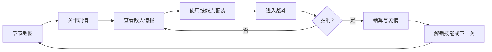
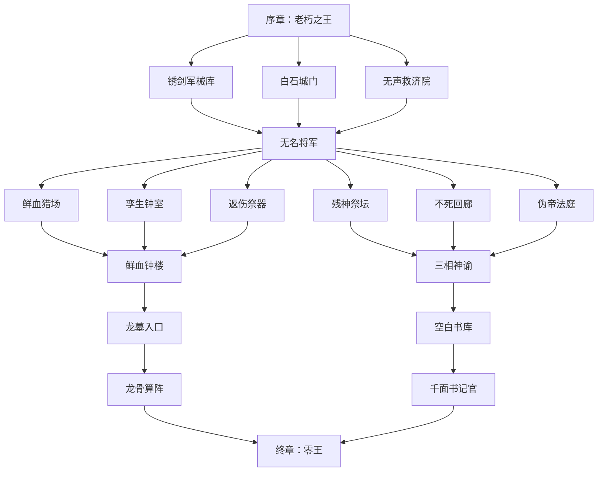

# Fida 单机战役、章节与树状关卡设计

## 1. 核心设定

数字王国正在被“归零”侵蚀，人的记忆、名字与意志会逐渐消失。玩家是一名能够重新组合数字的“算者”，进入沉寂王城寻找灾变原因。

王座上只剩一位衰老的国王。他已经无法正常交谈，只会依照生前记忆重复几套固定动作，展示王冠中封存的全部技能。演示结束后，他再次陷入沉寂。玩家必须击败他，取得第一枚王冠碎片，并沿着碎片留下的记忆进入后续章节。

战役的核心成长不是永久增加数值，而是：

1. 通关关卡，解锁新的技能。
2. 每关开始获得固定的技能点预算。
3. 在预算内自由组合已解锁技能。
4. 根据敌人的数字、技能和行为模式调整配装。

## 2. 战役主循环



失败不损失资源。玩家可立即重试，也可返回配装界面改变技能组合，形成“观察敌人 → 调整构筑 → 再次挑战”的单机体验。

## 3. 序章：沉默的王座

### 关卡 0-1「老朽之王」

**剧情目标：**进入王城、认识国王、理解基础规则并击败他。

**场景：**破败王座厅。国王坐在王座上，身体由暗淡数字组成。玩家靠近后，他只说一句：“若你仍记得加法……便证明给我看。”

**教学方式：**国王使用专用的 `ScriptedTutorialAgent`，不进行胜率计算，只按固定阶段行动。每段开始时可设置双方数字，保证演示必然发生；关键选择高亮，错误选择不消耗回合。

| 阶段 | 固定演示 | 玩家学到的内容 |
|---|---|---|
| 1. 试算 | 引导玩家选择自己的数字，再借用场上另一个数字 | 相加、对 10 取模、不能选择自己的同一数字 |
| 2. 剑与药 | 依次形成 7/8 和 9 | 选择攻击目标、选择治疗目标、效果后数字归 1 |
| 3. 零之盾 | 玩家形成单个 0，国王随后固定攻击 | 0 可格挡一次攻击，破盾后归 1 |
| 4. 王室算式 | 依次展示 1-6、5-5、6-6、0-0 | 双数字组合与更强效果 |
| 5. 王冠残响 | 国王用五组短演出预览全部技能 | 只建立技能印象，不要求玩家此时记忆 |

“王冠残响”按四个功能组演示，避免十四个技能逐个打断战斗：

- 生存：加防御、双倍防御、双倍生命、三倍生命。
- 强攻：加攻击、双倍攻击、龙、变。
- 改数：神、仙、同、帝。
- 代价：魔、血。

演示结束后，国王的 Agent 动作队列耗尽。他不再选择数字，也不再反击，只维持沉默。玩家在自由战斗阶段将其生命值打到 0。

**结尾剧情：**国王化为灰尘，只留下第一枚碎片和一句残缺记忆：“不要让零……戴上王冠。”玩家解锁“加攻击”和“加防御”，正式进入第一章。

> 教学关的任务是让玩家会操作。十四个技能只做视觉预告，之后每个技能仍需在对应关卡重新教学。

## 4. 树状战役地图

战役不是依次完成 1-1、1-2、1-3 的直线，而是一张可以回访的树状地图。玩家可以先查看每个节点的敌人、技能奖励和剧情摘要，再决定前往哪条分支。



### 节点开放规则

- 完成序章后，第一层的 3 个节点同时开放。
- “无名将军”要求第一层任意完成 2 个节点；未完成的节点不会消失，可以之后返回。
- “鲜血钟楼”和“三相神谕”分别要求所在分支任意完成 2 个前置节点。
- 击败任意一个分支 Boss，即可继续该分支后方的高阶技能路线。
- 完成“龙骨算阵”或“千面书记官”中的任意一个，即可挑战普通结局的零王。
- 清理整棵技能树后再挑战零王，会追加第三阶段并开放真结局。

这种结构允许玩家为了想要的技能主动选择路线。例如偏防守的玩家可以先走白石城门，喜欢连锁的玩家可以优先前往残神祭坛，追求高伤害的玩家则可尽快打通龙墓路线。

### 地图节点表现

每个节点在进入前展示五项关键信息：敌人数量、主要技能、是否存在增援、技能点预算和通关奖励。尚未到达的节点只显示剪影和一句剧情线索，避免提前泄露全部敌人机制。

节点使用四种状态：

- **可挑战：**路径已连通，满足前置条件。
- **已完成：**显示最佳回合数和曾使用的配装，可以重复挑战。
- **可跳过：**不是当前主线的必要节点，但包含技能或剧情碎片。
- **真结局必需：**普通结局可以跳过，收集全部碎片时必须完成。

重复挑战不会再次获得技能，但可以解锁更完整的敌人情报、特殊对话或关卡评价。地图界面始终允许退回已经开放的上层节点，不设置一次选择后永久封闭的路线。

## 5. 章节、节点与剧情

全战役共 **18 个战斗节点**。每一章对应地图上的一层或一条主枝，而不是固定的游玩顺序。

### 序章「沉默的王座」

#### P：老朽之王

沿用前文的脚本教学。国王展示数字规则和十四种技能的残响，随后动作队列耗尽，坐回王座。玩家击败他后获得“加攻击”“加防御”，并发现三条离开王宫的道路。

国王的最后一句话并不完整：“我将所有人的痛苦……归为零。”这句话在不同分支会得到不同解释。

### 第一章「失声的城墙」——基础构筑

三个起始节点可以自由选择，代表输出、防御和生存三种最容易理解的构筑方向。

| 节点 | 敌人编成与行为 | 剧情内容 | 通关奖励 | 点数 |
|---|---|---|---|---:|
| A1 锈剑军械库 | 2 名锻兵负责攻击，1 名验剑官会强化下一次伤害 | 军械库仍在制造一场早已结束的战争所需的武器 | 双倍攻击 | 3 |
| A2 白石城门 | 盾像降低伤害，2 名弩像负责稳定输出 | 城门保护的不是幸存者，而是一座空城 | 双倍防御 | 3 |
| A3 无声救济院 | 2 名病患攻击，医师持续治疗残血目标 | 医师用抹去记忆的方式让病人忘记痛苦 | 双倍生命 | 3 |
| AG 无名将军 | 第一阶段为将军 + 盾卫；盾卫倒下后，2 名锈剑兵增援 | 将军透露“归零”最初是国王为终止战争下达的命令 | 三倍生命、王城碎片 | 5 |

无名将军只要求完成 A1～A3 中任意两个节点。玩家因此会带着不同的技能组合进入 Boss 战，遗漏的第三个技能仍可在之后补取。

### 第二章分支 A「鲜血钟楼」——代价与回合控制

钟楼保存着战争最后一天的时间。每次钟响，死者都会按原来的动作重新站起。

| 节点 | 敌人编成与行为 | 剧情内容 | 通关奖励 | 点数 |
|---|---|---|---|---:|
| B1 鲜血猎场 | 3 名猎手集火同一目标，残血时优先通过攻击回血 | 猎手已经忘记猎物，只记得“活下去” | 血 | 7 |
| B2 孪生钟室 | 双子通过“同”制造相同数字；第三回合钟灵加入 | 两名守钟人共享同一段记忆，其中一人其实早已死去 | 同 | 7 |
| B3 返伤祭器 | 魔像承担伤害，2 个祭器为它制造攻击机会 | 祭器把战争双方受到的伤害永远互相返还 | 魔 | 7 |
| BG 鲜血钟楼 | 第一阶段为钟楼主母 + 2 名猎手；主母半血后，阵亡猎手以钟声残影重新加入 | 玩家敲停大钟，让这一天第一次真正结束 | 钟楼碎片 | 10 |

Boss 的难点不是高血量，而是第二阶段重新加入的残影会改变行动顺序。玩家必须决定先处理可以吸血的残影，还是抢先击败主母。

### 第二章分支 B「神魔庭院」——自由改数

这里供奉着国王曾经咨询过的三种答案：承受痛苦后改变命运、在伤害他人后重写结果，以及以绝对权力规定数字。

| 节点 | 敌人编成与行为 | 剧情内容 | 通关奖励 | 点数 |
|---|---|---|---|---:|
| C1 残神祭坛 | 残神祭司受伤后自由改数，2 名信徒负责制造连锁机会 | 祭司相信只有经历伤害的人才有资格改变命运 | 神 | 8 |
| C2 不死回廊 | 2 名仙侍攻击后改数，石像负责拖延和保护 | 仙侍不断修改结果，因此永远无法结束自己的战斗 | 仙 | 8 |
| C3 伪帝法庭 | 伪帝每回合开始改数，文武侍从分别负责攻防 | 一个没有臣民的人仍每天宣布新的数字律法 | 帝 | 8 |
| CG 三相神谕 | 第一阶段使用玩家已完成的两个分支技能；第二阶段召唤掌握第三种技能的新敌人 | 神谕指出国王没有被零王取代——零王正是国王主动舍弃的那部分意志 | 神谕碎片 | 11 |

“三相神谕”会读取玩家在 C1～C3 的完成情况。Boss 使用玩家已经见过的两个技能，第二阶段加入的敌人则展示尚未完成节点的第三种技能。这样既保留路线自由，也不会让未走路线的机制毫无预警地出现。

### 第三章分支 A「龙墓」——极限爆发

只有击败鲜血钟楼后才能进入。这里埋葬着王国用于计算战争胜率的龙形兵器。

| 节点 | 敌人编成与行为 | 剧情内容 | 通关奖励 | 点数 |
|---|---|---|---|---:|
| D1 龙墓入口 | 龙首负责输出，两段龙骨分别负责造数和减伤 | 龙并非生物，而是一台以两数之和预测死亡人数的机器 | 龙技能试用 | 12 |
| D2 龙骨算阵 | 第一阶段攻击龙骨；一段龙骨被毁后，新龙首加入并继承场上两数之和 | 算阵算出了王国必败，促使国王启动“归零” | 龙、龙骨碎片 | 14 |

“龙”在理想数字下拥有极高伤害，并能与双倍攻击和血形成爆发构筑。敌方会提前一回合显示龙首准备读取的两个数字，让失败显得可以预判。

### 第三章分支 B「空白书库」——稳定改写

只有击败三相神谕后才能进入。书库中的史书没有被烧毁，而是所有数字都被书记官改成了零。

| 节点 | 敌人编成与行为 | 剧情内容 | 通关奖励 | 点数 |
|---|---|---|---|---:|
| E1 空白书库 | 2 名墨吏改变攻击数值，纸卫负责提供护盾 | 每本书都记录着国王尝试过、但最终放弃的解决方案 | 变技能试用 | 12 |
| E2 千面书记官 | 第一阶段由书记官稳定制造高伤害；第二阶段加入 2 个复制玩家低费技能的墨影 | 书记官承认自己篡改了伤亡数字，却无法改变真实结局 | 变、书库碎片 | 14 |

“变”的单次理论伤害低于理想状态的“龙”，但它可以稳定选择需要的伤害值，因此同样拥有很高的构筑上限。

### 终章「归零王冠」——路线结算

#### F：零王

玩家回到王座厅。老国王的灰尘被各条路线取得的碎片重新拼合，但站起来的是他舍弃姓名、记忆和痛苦后留下的“零王”。

| 阶段 | 敌人编成 | 机制 |
|---|---|---|
| 第一阶段：空王座 | 零王 + 2 个王冠残响 | 残响分别模仿玩家最常使用的攻击技能和防御技能 |
| 第二阶段：王冠核心 | 残响全灭后，王冠核心作为新敌人加入 | 核心每回合改写一次行动顺序；零王使用玩家尚未取得的技能 |
| 第三阶段：老王归来 | 仅在全节点完成时出现老国王意志 | 老国王暂时成为中立单位；玩家可利用他的数字，也可能受到他的无差别攻击 |

完成任意一条高阶路线即可进入前两个阶段并获得普通结局。清理全部节点、集齐所有碎片后，第三阶段开放；胜利后玩家可以选择：

- **摧毁王冠：**所有被封存的痛苦与记忆一同回归，人们重新开始生活。
- **继承王冠：**玩家成为新的算者之王，解锁高难度“无尽王座”模式。
- **归还姓名：**真结局选项。玩家将碎片归还老国王，让他以人的身份承认自己的错误并安静死去。

## 6. 遭遇与增援设计

- 普通节点首轮出现 2～3 名敌人，分别承担输出、防御、治疗或改数职责。
- 精英和 Boss 节点拥有第二阶段。触发条件优先使用“关键敌人被击败”或“经过固定回合”，避免单纯堆高生命值。
- 第二阶段加入 1～2 名新敌人或替换核心敌人，并改变技能组合与行动顺序。
- 增援至少提前一回合预告，展示加入位置、敌人类型和预计行动时机。
- 新敌人加入后通常从下一轮开始行动；只有明确标记“伏击”的关卡可以立即行动。
- 同一波敌人的能力需要相互配合，但必须存在清晰的优先击杀目标。
- 场上建议最多同时存在 4 名敌人，死亡单位立即退出行动队列。
- 第二阶段应改变决策问题，而不只是增加生命。例如增加治疗者、打乱行动顺序或复制玩家技能。

### 多敌人的行动经济

当玩家独自面对 3 名敌人时，敌方天然拥有更多行动次数。因此不能把每个敌人都设计成完整强度的单挑对手：

- 每组通常只有 1 名核心输出，其余敌人的行动以造数、治疗、防御或蓄力为主。
- 普通杂兵建议拥有 3～5 点生命，精英为 6～9 点，Boss 再根据阶段单独配置。
- 辅助敌人应拥有更低生命，让玩家可以通过正确集火迅速减少敌方行动次数。
- 增援加入的当回合只播放入场效果，从下一轮开始行动；伏击关例外，但必须提前明确提示。
- Agent 的攻击权重按整个敌方队伍计算，避免三个敌人在同一轮都选择最高伤害动作。
- 二阶段 Boss 可以获得新能力，但不应同时保留全部旧增益和满编杂兵。

## 7. 技能点与解锁规则

### 配装规则

- 点数是**关卡预算**，不是会被消耗的货币。
- 每个节点的预算由节点难度固定，不根据玩家累计完成了多少支线计算。
- 只能装备已解锁技能，技能总费用不能超过本关上限。
- 可少用点数，不允许超额；进入战斗前保存本关配装。
- 首次解锁时自动进入一次短教学，并提供推荐配装按钮。
- 同类生命倍率技能互斥，例如“双倍生命”和“三倍生命”不可同时装备。
- “龙”和“变”都会替换攻击伤害，二者互斥；它们仍可与倍率、吸血等技能形成高上限组合。
- 进战斗前有一个独立的同伴界面（立绘名册）：默认独自作战，可邀请同伴，最多两名（`CampaignCompanions.PartyLimit`，实际名额还受节点放行的名册限制）。数据在 `Content/campaign/companions.json`，序章在 Mara 醒来之前不允许带同伴。
- 配装界面只显示“队伍 `n / 上限`”的只读摘要；点它、按 `C` 或返回键回到同伴界面改队伍。
- 联机合作时同伴位由另一名玩家占用，合作战中不加入本地同伴。
- 回到低阶节点时仍使用该节点原有预算，避免用后期配装碾压教学内容；通关后可开放“不限点数”的练习模式。

### 建议费用

| 费用 | 技能 | 定价依据 |
|---:|---|---|
| 1 | 加攻击、加防御 | 效果直接、提升稳定，适合作为配装填充 |
| 2 | 双倍生命、双倍防御、血 | 提供生存能力，但不会直接控制数字 |
| 3 | 双倍攻击、三倍生命、同、魔 | 能形成明显构筑方向，需要特定局面配合 |
| 4 | 仙 | 攻击后自由改数，可继续制造效果链 |
| 5 | 神、帝、变 | 神与帝能自由改数并稳定触发组合；变能把每次攻击转化为稳定高伤害 |
| 6 | 龙 | 伤害取两数之和，上限极高，并会被双倍攻击和吸血进一步放大 |

“神”和“帝”的价值不只是一次改数，而是能主动制造 0、7/8、9 和双数组合，因此按核心构筑技能定价。“龙”和“变”都拥有高伤害上限：变更稳定，龙的理论爆发更高。费用仍需根据实际测试调整，重点观察“龙/变 + 双倍攻击”“龙/变 + 血”以及自由改数造成的连续结算。

## 8. Agent 设计层级

不同关卡不必都使用同一种 ONNX Agent，可按教学目标混合三种行为：

| 类型 | 用途 | 行为特点 |
|---|---|---|
| 固定脚本 Agent | 教学与剧情演出 | 严格按动作队列行动，可在指定阶段停机 |
| 规则 Agent | 普通关和机制关 | 按攻击、治疗、保命等权重选择合法动作 |
| 模型 Agent | 精英关、Boss、挑战模式 | 根据完整局面决策，提供重复游玩的变化 |

每个敌人应有可读的性格，而不只是难度差异。例如守卫偏攻击、祭司追求连锁、猎手优先吸血、零王按阶段切换策略。

## 9. 关卡配置建议

每关至少配置以下信息，方便后续用 JSON/CSV 数据驱动：

```text
节点编号、章节名、节点名、地图坐标
前置节点、开放条件、是否为真结局必需节点
开场/胜利/失败剧情
技能点预算、首次解锁技能、推荐配装
玩家与敌人的初始生命、初始数字、技能
敌人控制器类型、行为脚本或模型编号、队伍攻击权重
二阶段触发条件、增援名单、入场回合与行动顺序
教学步骤、胜利条件、失败条件、奖励
```

## 10. 实现状态

当前首版已经实现：

1. 18 节点树状地图、复数前置条件、可跳过节点和本地 JSON 存档。
2. 多技能配装、独立技能费用、预算校验，以及生命倍率和伤害替换技能互斥。
3. 老国王固定动作队列，动作耗尽后自动跳过回合。
4. 本地玩家与全部敌人的阵营划分、合法攻击/治疗目标和多敌人规则 Agent。
5. 按回合或敌人死亡数触发的动态增援，以及增援后的 UI/控制器重建。
6. 战后奖励、技能解锁、保留配装重试和返回地图。
7. 按章节拆分的内置数据，以及 `Content/campaign/nodes.json` 增补/覆盖入口。

仍可继续深化的内容：

- 将序章扩展为带暂停、数字预设和输入限制的完整逐步教学演出。
- 增加节点悬停情报、敌人技能图标、路线动画和锁定节点剪影。
- 为最终战加入按路线完成情况生成的第三阶段、行动顺序改写和三种结局演出。
- 通过实际试玩继续调整敌人生命、技能点费用和 Agent 队伍攻击权重。

战役配装不直接使用旧有 `Skill.Value`，费用统一由 `CampaignSkillBalance` 管理。
